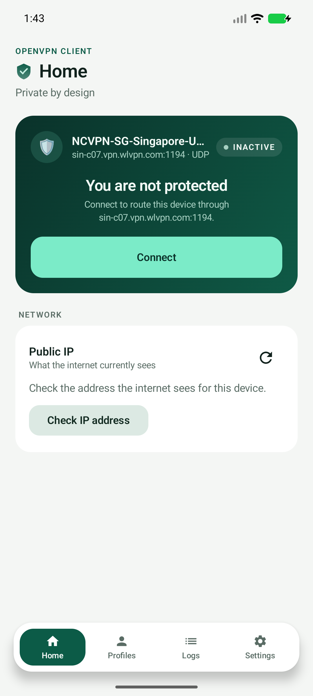
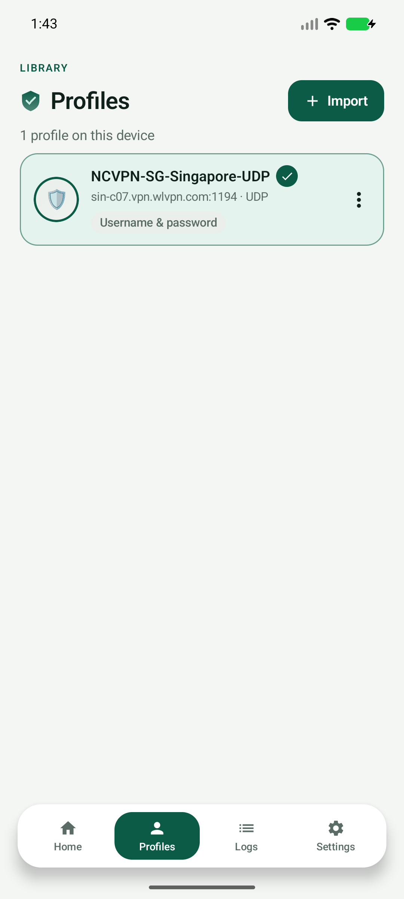
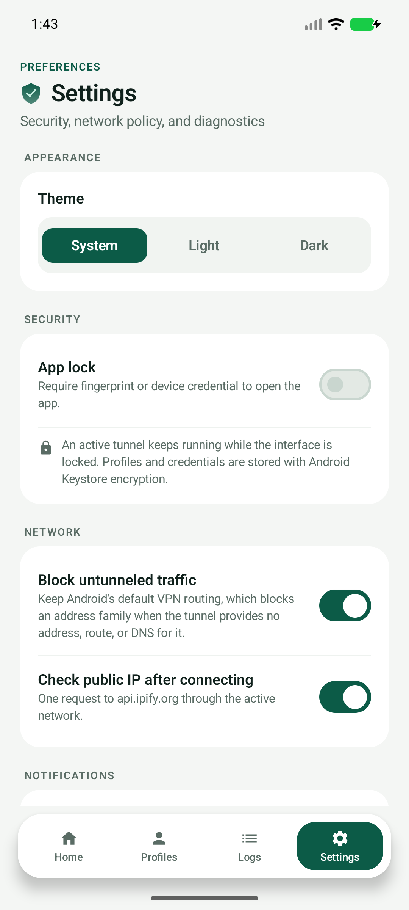
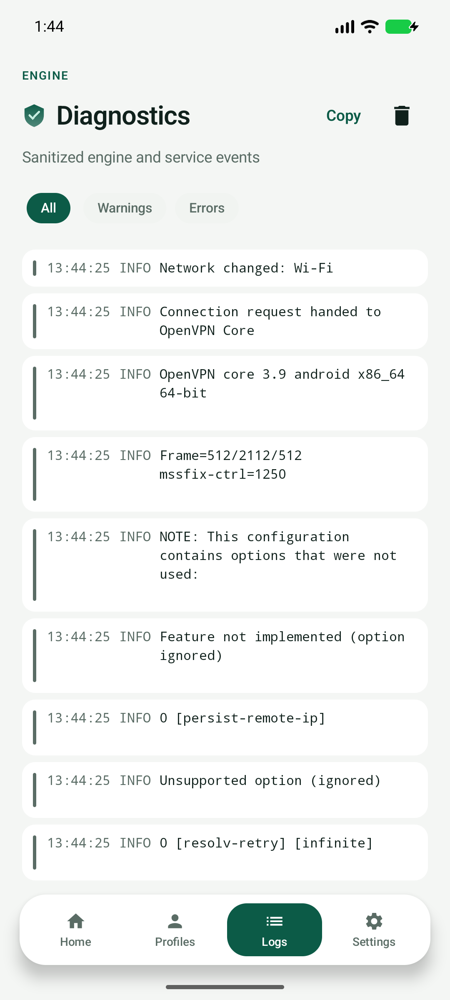
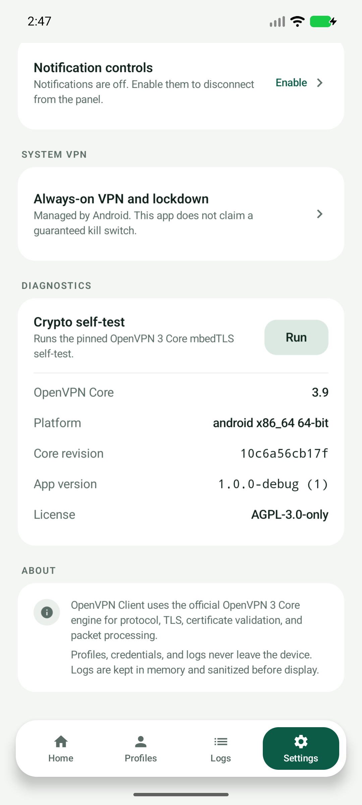

# OpenVPN Client for Android

[](https://github.com/smhasnanmonir/openvpn/actions/workflows/android.yml)
[](https://github.com/smhasnanmonir/openvpn/releases/latest)

A production-minded Android OpenVPN client built with Kotlin, Jetpack Compose,
Android `VpnService`, and the official **OpenVPN 3 Core** engine.

The app imports `.ovpn` profiles, stores profile material encrypted at rest,
authenticates with the engine, creates a real Android TUN interface, protects
transport sockets with `VpnService.protect()`, and reports only engine-derived
connection state. It is not a mock UI and does not implement its own VPN
protocol or cryptography.

> **Verification status (security/reliability backlog branch, #8–#21):** the
> app is a real client, not a mock UI. The base client (v1.0.2/PR #5) was
> exercised on an Android 11 x86_64 emulator against a controlled OpenVPN 2.7
> server: profile import, native engine self-test, TLS 1.3 tunnel, TUN
> establishment, ICMP through the tunnel, and clean disconnect. JVM tests, lint,
> R8, both ABI native builds, and GitHub Actions passed for that base. The
> current branch adds fail-closed DNS/trust policies, split tunneling, captive
> portal pause, configurable MTU, compression/cipher modes, lifecycle changes,
> a 16 KB ELF alignment CI gate and SBOM generation — these are covered by JVM
> policy tests and CI build gates, but **physical-device leak tests are not
> claimed**; see [docs/testing.md](docs/testing.md) and
> [the leak-test matrix](docs/security/leak-test-matrix.md). Do not treat a UI
> "Connected" state alone as proof of tunneling or leak protection.

## Features

- **Multiple profile import** through the Storage Access Framework, including
  selecting a `.ovpn` together with externally referenced certificate/key
  files.
- **Official OpenVPN 3 Core** parsing, TLS, certificate validation, credential
  handling, and packet framing. Pinned to release/3.9 (`10c6a56`).
- **System-wide VPN** using Android `VpnService` and a TUN interface owned by
  the engine after fd handoff.
- **Transport socket protection** through a native → Kotlin callback into
  `VpnService.protect()`.
- **Fail-closed tunnel DNS (default ON).** "Require tunnel DNS" refuses a
  connection when the server pushes no usable resolver (IPv4/IPv6) and no
  validated fallback is configured, instead of silently falling back to the
  underlying network. An optional fallback DNS list is validated and carried
  through the tunnel (ADR-008).
- **Strict server-trust policy.** Profiles must carry a CA, a
  `peer-fingerprint`, or a legacy `tls-remote`; untrusted profiles are rejected
  at import and refused at connect, and a same-name re-import with a different
  CA shows a warning. Revocation is documented as server/PKI-side (ADR-009).
- **Configurable TUN MTU.** Auto (server-pushed), 1500, 1400, or 1280. A fixed
  value is enforced at connect time with `pull-filter ignore tun-mtu` +
  `tun-mtu N` so the pushed value can't override it; the chosen value is shown
  in connection details (no auto-reconnect loop).
- **Explicit compression / cipher policy.** Compatibility compression
  (LZO-ASYM, default) or Strict (server-pushed compression fails loudly);
  profile ciphers (default) or AEAD-only (AES-GCM variants/ChaCha20-Poly1305 only, with
  a clear failure for non-AEAD profiles/servers). Policies are shown in
  diagnostics and are never silently changed (ADR-010).
- **Per-app split tunneling with leak warnings.** Off by default; include or
  exclude selected apps through a per-app picker. Home/Settings state how many
  apps bypass the tunnel, zero-app configurations are refused, and uninstalled
  packages are filtered safely (ADR-011).
- **Captive-portal pause.** Best-effort portal detection offers "Pause VPN to
  sign in"; while paused the UI says traffic is NOT protected, and the app
  auto-resumes once the network validates (ADR-012).
- **Always-on/lockdown readiness card.** Best-effort detection of the system
  Always-on/lockdown settings (UNKNOWN when unreadable), an explanation, and a
  link to system VPN settings. The app never claims an app-level kill switch.
- **Desired-state lifecycle.** The app persists the profile the user asked to
  connect (never a native pointer); Always-on/system restarts create a fresh
  session, and retries use bounded exponential backoff with bounded jitter
  (ADR-013).
- **Notification controls** with state, live connection chronometer, and
  Disconnect / Reconnect actions.
- **Quick Settings tile** for connect/disconnect control.
- **Encrypted storage** for profiles and credentials using AES-256-GCM keys in
  Android Keystore; storage is app-private and excluded from backups.
- **Fingerprint app lock** via `BiometricPrompt`.
- **Real traffic counters** from OpenVPN Core stats (TUN counters when
  available, otherwise transport byte counters) and an engine-derived
  connection timer.
- **Public IP check** through the active network (not presented as a complete
  leak test), with explicit loading, failure/retry and result states, and the
  egress path and check time shown with the address.
- **Profile switching from Home**: the selected-profile row in the connection
  hero opens a switcher for every saved profile, and linking to profile
  management. Selection is blocked while a tunnel is active.
- **Profile management**: rename display name only, built-in or custom emoji
  avatar selection (any 1–2 emoji, grapheme-validated), delete profile +
  credentials, duplicate detection, search.
- **Battery- and memory-conscious runtime**: diagnostics and state are observed
  only where they render, traffic polling follows connection and screen state,
  notification/tile updates are content-deduplicated, and decrypted profile
  bodies are not kept resident. The audit is documented in
  [docs/performance.md](docs/performance.md).
- **Sanitized diagnostics** with filtering, copy, and clear. Passwords, keys,
  profile contents, and auth payloads are never logged.
- **Validation / success / error / empty states** across import, connection,
  IP check, self-test, profiles, and logs.
- **Two ABIs** built from source: `arm64-v8a` and `x86_64`.
- **Supply-chain and release evidence.** CI checks packaged native-library 16 KB
  page alignment and `zipalign -P 16`, generates a CycloneDX SBOM (attached to
  releases), and runs scheduled advisory (osv-scanner) and secret (gitleaks)
  scans; Dependabot tracks Gradle and GitHub Actions. `SECURITY.md` defines
  patch deadlines (critical 7 / high 30 / medium 90 days) and the
  emergency-release process.
- **Truthful privacy/store documentation.** A complete privacy policy, Play
  `VpnService`/Data-safety/`QUERY_ALL_PACKAGES`/specialUse disclosure answers,
  and a release compliance checklist live under `docs/legal/` and
  `docs/compliance/`. No analytics, crash reporter, backend, or ad SDK.

## Screenshots

Captured from an Android 16 (API 36) x86_64 emulator, debug build, with the
current UI. The certificate-less username/password profile shown is a provider
export; the real tunnel was verified separately on an earlier emulator run (see
`docs/testing.md`). The captures predate the 1.2.0 Home network-card redesign
and profile switcher described above.

| Home | Profiles |
|---|---|
|  |  |

| Settings | Diagnostics |
|---|---|
|  |  |

Engine details in Settings. The Platform value wraps instead of colliding with
its label:



## Architecture at a glance

```
Compose UI
  └── AppViewModel / VpnController (StateFlow)
        ├── ProfileRepository ── Encrypted ProfileStore + CredentialStore
        │                         └── Android Keystore AES-256-GCM
        ├── ConfigImporter ──── SAF → private temp dir → OpenVPN Core merge/eval
        └── MyVpnService (foreground, VpnService)
              ├── Android TUN (VpnService.Builder.establish)
              ├── NativeSession → JNI → OpenVPN 3 Core OpenVPNClient
              │     ├── TunBuilderBase implementation
              │     ├── socket_protect() → VpnService.protect()
              │     ├── event/log callbacks → JVM
              │     └── provide_creds() / dynamic challenge
              └── Notification + Quick Settings tile
```

Only `MyVpnService` and native callbacks write VPN state. UI state is a
projection of those events; pressing Connect does not set `CONNECTED`.

More detail:
- [Architecture](docs/architecture.md)
- [OpenVPN Core integration](docs/openvpn-core-integration.md)
- [Security and threat model](docs/security.md)
- [Profile import](docs/profile-import.md)
- [Performance and power](docs/performance.md)
- [Testing](docs/testing.md)
- [Release process](docs/release.md)
- [Decisions (ADRs)](docs/decisions/) — including DNS fail-closed (ADR-008),
  strict server trust (ADR-009), compression/cipher modes (ADR-010), split
  tunneling (ADR-011), captive portal pause (ADR-012), desired-state lifecycle
  (ADR-013), backend scope (ADR-014), iOS scope (ADR-015)
- [Leak-test matrix](docs/security/leak-test-matrix.md),
  [MASVS/ASVS gap assessment](docs/security/masvs-gap-assessment.md)
- [Privacy policy](docs/legal/privacy-policy.md),
  [Play VpnService disclosure](docs/legal/play-store-vpn-disclosure.md),
  [release compliance checklist](docs/compliance/release-checklist.md)
- [Backend control-plane plan](docs/architecture/backend-control-plane.md),
  [iOS plan](docs/architecture/ios-plan.md) (both explicitly not implemented)

## Repository layout

```
app/src/main/java/com/smhasnan/openvpn/
  config/        profiles, encrypted storage, SAF import, trust/security import policy
  crypto/        (security/) Keystore-backed secret box
  nativevpn/     Kotlin JNI facade + session ownership
  net/           public IP lookup
  settings/      preferences, theme/lock/network policy, Always-on status
  ui/            Compose screens, theme, dialogs, split-tunnel picker
  vpn/           VpnService, controller, state model, notification, QS tile,
                 DNS/MTU/split-tunnel/captive-portal/pause policies
app/src/main/cpp/
  native_bridge.cpp          JNI, session lifetime, callback marshaling
  engine_adapter/            OpenVPNClient + TunBuilderBase adapter
  CMakeLists.txt             native build entry point + generated core patches
  deps/                      generated per-ABI dependency installs (ignored)
third_party/openvpn3/        pinned git submodule (OpenVPN Core 3.9)
scripts/                     dependency fetch/build, 16 KB alignment, SBOM generation
docs/                        architecture, ADRs, security, legal, compliance,
                             integration, testing
.github/workflows/           CI + signed release + scheduled security scans
.github/dependabot.yml       Gradle/Actions update automation
```

## Install a release

Download the signed APK from the
[latest GitHub Release](https://github.com/smhasnanmonir/openvpn/releases/latest),
then:

```bash
adb install -r app-release.apk
```

The app requires Android 8.0+ (API 26). Verify the release signature against the
certificate digest documented in [docs/testing.md](docs/testing.md).

## Build

### Requirements

- JDK 17
- Android SDK platform 37 (installed as `platforms;android-37.0`) and Build
  Tools 36.0.0 (AGP default) + 37.0.0 (release-gate `apksigner`/`aapt2`)
- Android NDK `27.2.12479018`
- CMake `3.22.1` (from Android SDK)
- Ninja
- Network access for the first dependency fetch

The build uses the Gradle wrapper (`gradlew`, Gradle 9.6.0), AGP 9.4.1 and the
Kotlin 2.4.21 compiler bundled with AGP's built-in Kotlin support. Pinned native
dependencies are downloaded by `scripts/fetch-native-deps.sh` and verified with
SHA-256. OpenVPN Core is a git submodule pinned to an immutable commit.

### Commands

```bash
git clone --recurse-submodules https://github.com/smhasnanmonir/openvpn.git
cd openvpn

export ANDROID_SDK_ROOT=/path/to/android-sdk
./scripts/build-native-deps.sh arm64-v8a x86_64

./gradlew :app:assembleDebug :app:testDebugUnitTest :app:lintDebug
```

For a single ABI during development:

```bash
./gradlew -Pabis=arm64-v8a :app:assembleDebug
```

The debug APK is written to `app/build/outputs/apk/debug/app-debug.apk`.

### Signed release

Create `keystore.properties` (ignored by git), or provide the equivalent
environment variables:

```properties
storeFile=/absolute/path/release.jks
storePassword=...
keyAlias=...
keyPassword=...
```

Then:

```bash
./gradlew :app:assembleRelease :app:lintRelease
```

See [docs/release.md](docs/release.md) for CI signing secrets and GitHub
Release publishing.

## Android compatibility and policy notes

- `minSdk 26`, `targetSdk 35`, `compileSdk 37`.
- The foreground service declares
  `android:foregroundServiceType="specialUse"` with the required
  `FOREGROUND_SERVICE_SPECIAL_USE` permission and
  `PROPERTY_SPECIAL_USE_FGS_SUBTYPE="vpn"`. It does **not** claim
  `systemExempted`; the Play declaration is documented in
  [the disclosure doc](docs/legal/play-store-vpn-disclosure.md).
- Split tunneling declares the Play-restricted
  `android.permission.QUERY_ALL_PACKAGES` because Android 11+ package visibility
  otherwise prevents listing/applying arbitrary packages. The package list is
  used only locally for the per-app picker; it is never transmitted or logged.
- VPN consent is obtained through `VpnService.prepare()`; the app never
  auto-consents.
- The service is `START_STICKY` only for the Always-on/system restart path; a
  persisted *desired connected profile* (not a native pointer) drives restore and
  a fresh native session/TUN is always created.
- Android blocks an address family by default when the VPN has no address,
  route, or DNS server for it. The app keeps that default leak-prevention
  policy. The "Block untunneled address families" setting is on by default;
  disabling it intentionally allows fallback. See [security](docs/security.md).
- "Require tunnel DNS" defaults **on**: a server that pushes no usable resolver
  (and no user fallback) is refused rather than allowed to fall back to the
  underlying DNS. This is a deliberate behavior change; see the changelog.
- A kill switch is **not** implemented as an app-controlled promise. Use
  Android's system Always-on VPN / Lockdown if system-level lockdown is
  required; Settings shows a best-effort readiness card but never guarantees
  blocking.
- Compression compatibility mode (LZO-ASYM) and profile-driven ciphers remain
  the defaults; strict compression and AEAD-only modes are explicit opt-ins.

## License

This application is licensed under **AGPL-3.0-only**, matching the license of
the pinned OpenVPN 3 Core 3.9 revision. See [LICENSE](LICENSE),
[NOTICE](NOTICE), and [THIRD_PARTY_NOTICES.md](THIRD_PARTY_NOTICES.md).

The OpenVPN 3 Core 3.9 revision is AGPL-3.0-only with an OpenSSL linking
exception. Later upstream revisions are dual MPL-2.0/AGPL-3.0; that later
license does not apply to the pinned revision.

## Security

Never paste real credentials or private keys into bug reports. See
[SECURITY.md](SECURITY.md) for reporting and [docs/security.md](docs/security.md)
for the threat model and known limitations.
